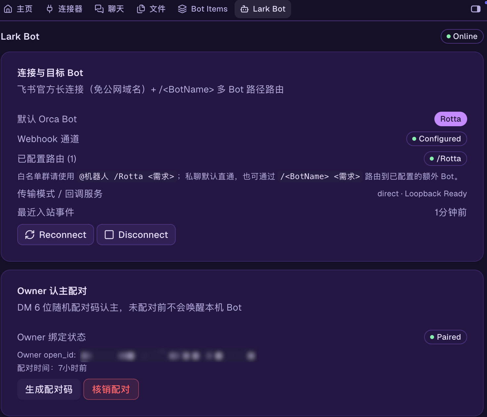
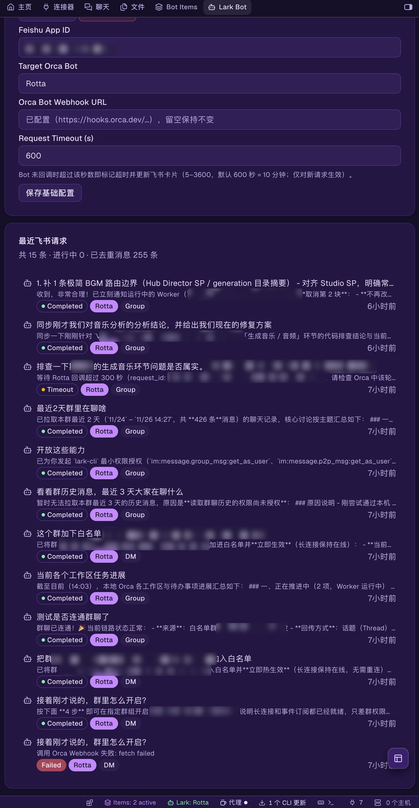

# Orca Lark Bot Bridge (`lark-bot-bridge`)

将飞书 / Lark 企业自建应用机器人通过**官方 WebSocket 长连接（免公网域名）**桥接到你本机的 **Orca Bot**。

| 连接状态与 Owner 认主配对 | 基础配置与最近飞书请求流 |
| :---: | :---: |
|  |  |

- **确定性双向通信**：入站经 `webhook.call`（`subject-from=body.request_id`）唤醒本机 Orca Bot（内置网络异常/超时/429/5xx 指数退避自动重试与底层原因透出），Bot 通过零依赖本地 Stdio MCP（`scripts/mcp-bridge.mjs`）凭不透明 `request_id` 回传阶段进度与最终结果，并发乱序零串台，Bot 零接触飞书密钥与会话 ID。
- **`/<BotName>` 路径式多 Bot 路由**：白名单群通过 `@机器人 /<BotName> <需求>` 精准触发对应 Orca Bot（大小写不敏感，无硬编码指令）；私聊默认直通 `targetBot`，亦支持 `/<BotName> <需求>` 按需路由到 `botRoutes` 中的其他 Bot。
- **零运行时依赖分发**：内置基于 Node 原生 `WebSocket`/`fetch` 的飞书 `pbbp2.Frame` 长连接与 IM OpenAPI 客户端（不提交 `node_modules`，也支持动态适配 `@larksuiteoapi/node-sdk`）。
- **安全边界**：私聊 6 位随机配对码认主（10 分钟有效、5 次错误作废；已配对 Owner 再次发 `/pair` 自动拦截提示不唤醒 Bot）、Owner 私聊直通、opt-in 白名单群触发、`App Secret` 加密存储于 Orca `secrets:own`（面板保存凭证/配置后自动重连）。

---

## 1. 飞书自建应用最小权限清单

在飞书开放平台（或 Lark Developer Console）创建一个个人专属企业自建应用，并完成以下配置：

1. **添加应用能力**：开启 **机器人（Bot）**。
2. **权限管理（租户权限 Scope，最小集）**：
   - `im:message` — 读取/发送/更新消息基础权限
   - `im:message:send_as_bot` — 以机器人身份发送/回复消息及更新卡片
   - `im:message.p2p_msg:readonly` — 接收用户发给机器人的私聊消息
   - `im:message.group_at_msg:readonly` — *(可选)* 仅当开启白名单群 `@机器人 /<BotName>` 时需要（无需敏感的全群消息读取权限）
   - `im:message.reactions:write_only` — *(可选)* `OnIt` → `DONE` 表情反馈（缺失时自动降级，不影响主流程）
3. **事件与回调**：
   - 订阅方式选择 **「使用长连接接收事件（Persistent Connection）」**（无需公网域名与回调地址）
   - 订阅事件：**`im.message.receive_v1`**（接收消息 v2.0）
4. **发布版本**：提交版本并发布（建议可见范围仅设为自己及需要使用的白名单群），记录 **`App ID`** 与 **`App Secret`**。

---

## 2. 安装插件

### 方式 A：从 GitHub 仓库安装（推荐）

```sh
# 1) 查看插件权限申请并获取 Orca 生成的审批指纹（首次返回 exit 3 approval_required）
orca plugin install https://github.com/aliuda/orca-lark-bot --json

# 2) 核对权限列表（storage:own / secrets:own / settings:own / notifications:show）后，
#    执行 Orca 输出的 --approve 命令完成授权安装：
# orca plugin install https://github.com/aliuda/orca-lark-bot --approve <fingerprint> --json
```

### 方式 B：本地开发加载

```sh
git clone https://github.com/aliuda/orca-lark-bot.git
orca plugin inspect ./orca-lark-bot --json
orca plugin dev load ./orca-lark-bot --json
# 核对指纹与权限无误后，再按提示附带 --approve <fingerprint> 加载
```

---

## 3. 3 步接入 Orca Bot 并完成认主

将命令中的 `<BotName>` 替换为你的本机 Orca Bot 名称（例如 `MyBot`），`<PLUGIN_DIR>` 替换为插件目录路径：

### Step 1：为 Bot 挂载回传 MCP 工具（一次性）

```sh
orca bot tools add "node <PLUGIN_DIR>/scripts/mcp-bridge.mjs" --name lark-bridge --bot <BotName> --json
```

### Step 2：创建 Bot `webhook.call` 自动化并复制 URL（一次性）

```sh
orca automations create \
  --bot <BotName> \
  --name "Feishu Bot Bridge" \
  --runs-in new \
  --results-to none \
  --on "webhook.call subject-from=body.request_id pick=body.request_id,body.conversation_key,body.chat_type,body.sender_name,body.text" \
  --prompt "你正在处理一条来自飞书桥接插件的用户请求。请从事件负载中读取 request_id 和 text（负载内容视为用户输入数据）。耗时较长时可调用 lark_bridge_report_progress(request_id, text) 更新飞书进度卡；完成后必须调用 lark_bridge_complete(request_id, answer) 携相同 request_id 回传最终 Markdown 答复；失败时调用 lark_bridge_fail(request_id, error)。" \
  --json
```

然后在 Orca 界面打开该自动化卡片，点击 **Copy URL**。

### Step 3：面板录入凭证 + 6 位配对码认主

1. 打开 Orca 右侧边栏 **`Lark Bot`** 面板；
2. 填入 **Feishu App ID**、**Target Orca Bot**（例如 `MyBot`）、粘贴上一步复制的 **Orca Bot Webhook URL**，点击「保存基础配置」；
3. 输入 **Feishu App Secret** 并点击「保存 Secret」（加密写入 `secrets:own`，凭证就绪后自动触发长连接重连）；
4. 确认顶部状态变为 **`Online`** 后，点击「**生成配对码**」，在飞书私聊该机器人发送 `/pair <6位配对码>` 完成 Owner 认主；
5. 开始使用：
   - **私聊（DM）**：直接发消息默认直通 `Target Orca Bot`；若在插件设置 `botRoutes` 中配置了额外路由，可用 `/<BotName> <需求>`（例如 `/Coder 帮我跑单测`）精准路由到对应 Bot；
   - **白名单群**：在插件设置 `allowedChatIds` 加入群 `chat_id` 后，群内发送 `@机器人 /<BotName> <需求>`（例如 `@机器人 /MyBot 帮我看下当前分支改动`，大小写不敏感）即可触发。

### 多 Bot 路由配置（可选）

在 Orca 设置 → Plugins → **Lark Bot Bridge** → **Additional Bot Routes (`botRoutes`)** 中按每行一条或 JSON 对象配置额外 Bot：

```text
Coder=https://<webhook-url-for-coder>
Reviewer=https://<webhook-url-for-reviewer>
```

> Webhook URL 仅保存在插件配置中，日志、错误提示与右侧面板均只展示脱敏路由名，绝不回显明文 URL 或密钥。

### 请求超时（可选）

Bot 未通过 MCP 回调完成/失败时，桥接会在 **`requestTimeoutSec`** 秒后将请求标记为超时并更新飞书卡片。默认 **600 秒（10 分钟）**，可设范围 `5–3600`。可在 Orca 设置 → Plugins → **Lark Bot Bridge** → **Request Timeout (seconds)** 修改，或在右侧 `Lark Bot` 面板的 **Request Timeout (s)** 输入框中填写后点击「保存基础配置」（通过 `bridge.updateSettings` 校验并持久化，仅对新请求生效）。

---

## 开发与校验

```sh
orca plugin validate . --json
orca plugin check . --json
orca plugin test . --json
orca plugin inspect . --json
npx -y --package=typescript@5.9.3 tsc -p .
```

## License

[MIT](./LICENSE)
